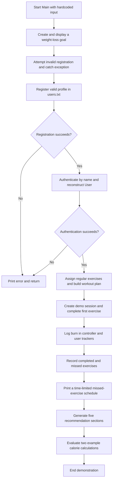

# Workout Scheduler

A Java lab group project by second-year students at SSN College, Anna University. The project demonstrates how Java classes collaborate to register a profile, select exercises, create workout sessions, track completion, reschedule missed exercises, and generate recommendations.

The current application is a **console demonstration with hardcoded inputs**. It has no interactive menu, GUI, web server, or SQL database. Its recommendations and calorie calculations use rules written in the source code.

## Documentation for learning and viva

| Read this | What you will learn |
| --- | --- |
| [HLD — High-Level Design](docs/HLD.md) | The big picture: modules, responsibilities, architecture, and data flow |
| [LLD — Low-Level Design](docs/LLD.md) | Individual classes, method contracts, algorithms, formulas, and important flowcharts |
| [Viva preparation](docs/VIVA.md) | Java concepts with source examples, worked demo output, questions and answers, and revision tasks |

Read this README first, then HLD, then LLD. Use the viva guide to practise explaining the code aloud. Mermaid diagrams appear in GitHub's Markdown preview; in an editor without Mermaid support, read the labelled nodes and arrows as the flow.

## Run the project

Install a JDK, which supplies both `javac` (compiler) and `java` (runtime). The source uses Java 8 language features such as lambdas and generics; the documented demo was verified with OpenJDK 25.0.3. No Maven, Gradle, or external Java libraries are required.

From the repository root in macOS/Linux:

```sh
java -version
javac -version
mkdir -p bin
find src -name '*.java' -print > /tmp/workout-scheduler-sources.txt
javac -Xlint:unchecked -d bin @/tmp/workout-scheduler-sources.txt
```

`-d bin` places compiled `.class` files under `bin`, using package directories. `@...` tells `javac` to read the source filenames from the text file. `-Xlint:unchecked` reports unsafe generic operations.

For a fresh demo that preserves your existing profile file:

```sh
workout_repo_dir="$PWD"
workout_demo_dir="$(mktemp -d)"
(cd "$workout_demo_dir" && java -cp "$workout_repo_dir/bin" Main)
```

`-cp` sets the classpath: where Java looks for compiled classes. `Main` is in the default package, so its launch name is simply `Main`. The temporary directory receives the demo's `users.txt`. Keep that directory if you want to inspect the file.

You can also run `java -cp bin Main` from the repository root. That creates or reads `users.txt` in the root. A second run in the **same working directory** tries to register the same name again, prints a duplicate-user error, and returns early. Use a new temporary directory for each full demonstration; do not delete a real profile file to rerun the demo.

Expected milestones on a fresh run:

```text
Registration Validation Notice: Age must be between 1 and 120 years. Provided: -5
User 'Sai Saranya' authenticated successfully.
Successfully generated Workout Plan containing 5 workout sessions.
Session logged to history: 1 completed, 4 missed.
Total Burned: 264.0 kcal | Daily Target: 1177.3 kcal
Total Missed Burn: 1134.0 kcal from missed exercises.
Overall Completion Rate: 20.0%
SYSTEM EXECUTION COMPLETE
```

## Main demonstration flow



## Specific feature inventory

**Demo** means `Main` exercises the feature, either directly or through another class. **Available** means the code exists but the current demo does not use that path. This is a list of implemented behavior, not a list of future promises.

| # | Feature | Source / entry point | Status | Java concepts to explain |
| --- | --- | --- | --- | --- |
| 1 | Validate profile name, age, size, goal reference, and availability | `User` constructors | Demo | Encapsulation, checked exceptions, constructor chaining |
| 2 | Validate profile updates and recalculate BMR/target for relevant setters | `User` setters | Available | Mutators, validation, object collaboration |
| 3 | Generate in-process user IDs starting at 1001 | `User.idCounter` | Demo | Static class state, post-increment |
| 4 | Represent and check weight-loss goals | `WeightLossGoal.isRealisticGoal` | Demo | Abstract classes, inheritance, overriding |
| 5 | Represent and check weight-gain goals | `WeightGainGoal.isRealisticGoal` | Available | Inheritance, overloaded constructors |
| 6 | Register profile records and reject duplicate names | `Login.register` | Demo | FileWriter, exceptions, try-with-resources |
| 7 | Look up a saved profile by name and rebuild its objects | `Login.authenticate`, private `findUser` | Demo | FileReader, parsing, object construction |
| 8 | Count successful registrations and authentications in this JVM | `Login.noOfUserLogins` | Demo | Static variables |
| 9 | Supply predefined regular and additional exercise pools | Four static methods in `ExerciseRepository` | Regular pools used; additional available | Static factory methods, typed collections |
| 10 | Assign regular exercises by goal and cardiac flag | `RegularExerciseAssigner` | Demo for non-cardiac weight loss | Interface implementation, `instanceof` |
| 11 | Assign supplemental exercises with stricter cardiac filtering | `AdditionalExerciseAssigner` | Available | Interface polymorphism, filtering |
| 12 | Estimate cardio calories | `WeightLossExercise.calculateCaloriesBurned` | Demo | Method overriding, arithmetic |
| 13 | Estimate strength calories | `WeightGainExercise.calculateCaloriesBurned` | Demo example | Runtime polymorphism |
| 14 | Adjust exercise duration/intensity using BP and intensity inputs | Both exercise subclasses' `recalculateDuration` | Available | Overriding, branching, state mutation |
| 15 | Calculate an exercise quota per workout day | `ExerciseScheduler.computeNoOFExercisesperday` | Demo | Integer arithmetic, casting, `Math.ceil` |
| 16 | Distribute exercises into sequential workout sessions | `ExerciseScheduler.getWorkoutSchedule` | Demo | Lists, loops, quotient/remainder |
| 17 | Print the next quota and track/reset the print cursor | `displayScheduledExercises`, `hasMoreExercises`, `resetScheduleIndex` | Available | Instance state, `final` break constant |
| 18 | Hold a plan and retrieve its one-based session | `WorkoutPlan.getWorkoutForDay`, `addWorkout` | Plan constructed; lookup/mutation available | Object containment, index conversion |
| 19 | Hold a workout and sum its exercise durations | `Workout` constructors, `calculateWorkoutDuration` | Demo | Constructor overloading, references |
| 20 | Mark an exercise complete by ID | `Controller.completeExercise`; `Workout.markCompletedExercise` | Controller path used; Workout helper available | Search loop, mutable objects |
| 21 | Calculate and cache calories using a bounded generic helper | `CalorieCalculator<T extends Exercise>` | Demo | Generics, lambda, `Function`, autoboxing |
| 22 | Calculate BMR and activity/goal-based calorie targets | `CalorieTracker.calculateBMR`, overloaded target methods | Demo | Method overloading, `instanceof` |
| 23 | Log burned/missed calories and compute remaining target | `CalorieTracker` logging and deficit methods | Demo | `List<Float>`, running totals |
| 24 | Record completed/missed lists per session | `WorkoutHistory.addWorkoutRecord` | Demo | Nested generic lists |
| 25 | Update, filter, clear, and report history | Other `WorkoutHistory` methods | Available | Indexed collections, `StringBuilder` |
| 26 | Derive missed exercises from a session and log their calories | Four-argument `Controller.rescheduleMissedExercises` | Demo | Method overloading, separation of responsibilities |
| 27 | Reschedule unfinished exercises collected from existing history | Three-argument controller overload | Available | Nested iteration, list aggregation |
| 28 | Print a recovery schedule with daily limits and five-minute breaks | `MissedExerciseRescheduler.rescheduleMissedExercises` | Demo | Greedy ordered traversal |
| 29 | Return rescheduled `Workout` objects using stored scheduling settings | `MissedExerciseRescheduler.getRescheduledWorkouts` | Available, with limitations | Stateful helper, object creation |
| 30 | Compute completion percentage and current full-session streak | `WorkoutPerformanceAnalyzer` | Demo through recommendations | Reverse traversal, floating-point division |
| 31 | Describe performance, compare latest two calorie logs, find best session | Analyzer's other four methods | Available | Threshold comparisons, linear scan |
| 32 | Generate calorie, streak, history, cardiac, and recovery advice | Five `RecommendationServices` methods | Demo | Rule-based branching, string construction |
| 33 | Coordinate services and build one combined report | `Controller.getRecommendation` | Demo | Delegation, fallback references |
| 34 | Report invalid input/authentication with custom exception types | `exceptions` package | Demo for invalid input | Exception inheritance, `throw`/`throws`/`catch` |

`CardiacRiskException` is declared but never thrown. `User implements Serializable` is a declaration; the application currently saves text fields, not serialized object graphs. Both are explained in the design and viva documents.

## Repository map

```text
src/
  Main.java                 Hardcoded end-to-end console demonstration
  login/                    Text-file registration and name lookup
  models/                   User profile and owned tracker/history
  goals/                    Abstract goal and two goal subclasses
  exercises/                Abstract exercise, subclasses, predefined pools
  assigners/                Assignment interface and two implementations
  scheduler/                Initial allocation and missed-exercise recovery
  workouts/                 Workout, WorkoutPlan, WorkoutHistory
  tracker/                  Calorie calculation and calorie state
  analytics/                Performance calculations and recommendation strings
  exceptions/               Base checked exception and four subclasses
  user_database.txt         Legacy sample; not read by Login
  users.txt                 May exist after running from src; runtime data
```

`Login` uses the relative filename `users.txt` in the **process working directory**, regardless of the package location. The tracked `src/user_database.txt` uses semicolon-separated sample data; the current login parser expects comma-separated records and does not read that sample. Runtime profile files are not needed to build the application.

## Major Java concepts

The strongest viva examples are **abstraction**, **inheritance**, **runtime polymorphism**, **encapsulation**, **interfaces**, **overloading**, **checked exceptions**, **collections**, **bounded generics**, **lambdas**, **file I/O**, and **try-with-resources**. See [the concept-to-code map](docs/VIVA.md#java-concepts-with-real-examples) for explanations and exact source links.

## Current limitations to understand

- Login is a case-insensitive name lookup. There are no passwords or authentication tokens.
- Only ten profile fields persist. IDs, blood pressure updates, history, calorie logs, and completion state do not persist.
- The initial scheduler distributes each exercise once; it does not generate a dated calendar or fill every week. It does not use `hoursPerDay`.
- The recovery schedule printed by the controller is not appended to the existing `WorkoutPlan`.
- Calorie log entries have no dates. Remaining target uses the latest log entry, not a sum for a calendar day.
- Completing or recording the same session repeatedly can double-count state; operations are not idempotent.
- Some getters expose mutable lists, and copies of lists still share their exercise objects.
- `User` is marked serializable, but referenced goal/history/tracker classes are not serializable. Full object serialization is not implemented.
- Code comments/output mentioning buffered readers/writers do not match `Login`, which uses `FileReader` and `FileWriter` directly.

The [LLD](docs/LLD.md#limitations-and-edge-cases) explains these precisely. Knowing these boundaries makes your viva answers more accurate and gives you concrete improvement ideas.
