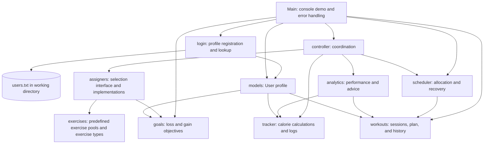
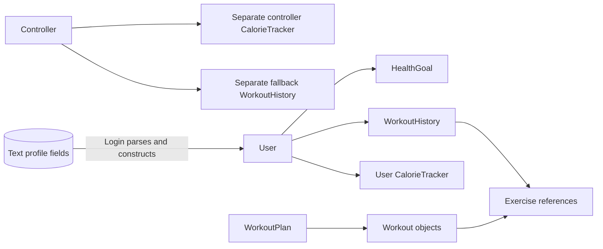
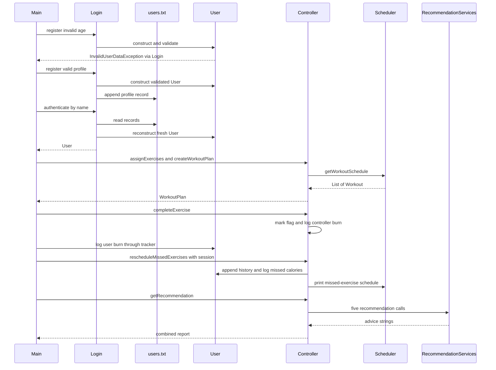

# High-Level Design — Workout Scheduler

[README](../README.md) · [LLD](LLD.md) · [Viva guide](VIVA.md)

Prepared for second-year Java lab students at SSN College, Anna University. This document describes the source at base commit `4751e7b`. It describes implemented behavior; suggested improvements are explicitly labelled.

## 1. What is HLD?

**High-Level Design** explains the system as a collection of collaborating modules. It answers: What does the system do? What are the main parts? Where does information move? It avoids listing every getter or implementation statement; those belong in the LLD.

A module here is a Java package grouping related classes. A class defines a type; an object is one instance of that type with its own state.

## 2. Problem and scope

The educational problem is to coordinate a user's goal, exercise selection, workout allocation, completion history, and calorie feedback. Keeping all of this in one large method would make each change difficult to understand. The project separates these responsibilities across classes and uses a controller to coordinate most workout operations.

The executable demonstrates one profile using hardcoded data. It intentionally attempts an invalid registration, handles that exception, then runs a valid profile through the workflow. It does not collect input interactively.

| Requirement represented in code | Current implementation |
| --- | --- |
| Reject invalid profile values | `User` constructor and selected setters throw checked exceptions |
| Save and recover a profile | Append ten text fields and look up a name in `users.txt` |
| Support loss/gain exercise types | Two goal subclasses and two exercise subclasses |
| Select by goal and cardiac flag | Assignment implementations filter predefined pools |
| Build an initial plan | Split the exercise list into sequential sessions |
| Record execution | Set completion flags and store per-session completed/missed lists |
| Recover missed work | Print an ordered schedule constrained by available minutes |
| Provide feedback | Fixed-rule strings for calories, streak, completion, cardiac flag, and recovery |

## 3. Architecture

Arrows represent use or object references, not network calls. Everything runs in one Java process. The diagram shows the main dependencies; details such as exception imports are omitted for readability.

This is a package-organized console application with controller/service separation. It is not a complete MVC framework: there is no separate GUI view, and `Main` also calls model and scheduler objects directly.

## 4. Modules and responsibility boundaries

| Package / entry | Main responsibility | Typical output |
| --- | --- | --- |
| `Main` | Build sample inputs, demonstrate workflows, print results, catch errors | Console output |
| `login` | Validate registration through `User`, write/read text profiles | New/reconstructed `User` |
| `models` | Keep profile, goal, availability, history, and tracker references | Validated profile state |
| `goals` | Represent goal data and check direction/rate/duration | Boolean realism result and display |
| `exercises` | Define exercise state, calorie rules, adjustment rules, and sample pools | Typed exercise objects |
| `assigners` | Select regular or additional exercises by goal and cardiac flag | `List<Exercise>` |
| `scheduler` | Split an initial list; pack missed work into time slots | Initial workouts or recovery console output |
| `workouts` | Represent one session, a plan, and per-session history | Stored lists and reports |
| `tracker` | Estimate calories, BMR, targets, and retain burn/missed totals | Numbers and formatted status |
| `analytics` | Derive performance metrics and fixed-rule advice | Strings |
| `controller` | Connect assignment, scheduling, tracking, history, and advice | Plan, report, or state updates |
| `exceptions` | Describe invalid input and failed lookup as checked errors | Exceptions caught by callers |

The controller currently constructs its own services in its constructor. `ExerciseAssigner` is an interface, but the controller selects `RegularExerciseAssigner` internally. The additional implementation exists without a public controller setter to swap it.

## 5. Data ownership and lifetime

A `User` creates a fresh history and tracker in its constructor. A `Controller` also creates a separate tracker and fallback history. These are different objects:

- `Controller.completeExercise` logs into the **controller tracker**.
- `Main` explicitly logs the same burn into the **user tracker**.
- The session rescheduling overload logs missed calories into the **user tracker**.
- `Controller.getRecommendation` uses the user's tracker/history when present; otherwise it uses controller fallback objects.

That distinction explains why removing the explicit user burn log would change the recommendation report even if completion still appeared successful.

Workout and history objects store exercise references. A new list container does not automatically clone the exercises inside it. This matters when an exercise's `isComplete` flag changes.

## 6. End-to-end workflow

`Main` also builds another scheduler to display sessions and constructs a demonstration workout containing all five assigned exercises. That demonstration workout is not the first one-exercise workout from the generated plan. This explains why its history contains one completed and four missed exercises.

## 7. Persistence boundary

The only storage mechanism in use is a local text file. `Login.FILE_NAME` is `users.txt`; it is resolved relative to the process working directory. The file holds comma-separated profile records, not a relational database and not serialized Java objects.

Saved: name, age, weight, height, cardiac flag, goal name, target days, target weight, days per week, hours per day.

Not saved: user ID, BP, original goal current weight, weekly goal rate, workout history, completion flags, calorie totals/logs, and login count. Authentication reconstructs a goal with the profile's weight and a fixed weekly rate, then constructs a new `User`. A later process therefore starts fresh runtime state.

The tracked `src/user_database.txt` sample has a different name and delimiter. It is not part of this runtime path.

## 8. Design choices and tradeoffs

| Choice | Why it helps this lab project | Tradeoff to explain |
| --- | --- | --- |
| Abstract goals/exercises | Common state with different subclass behavior | Some selection still uses explicit `instanceof` checks |
| Assignment interface | Defines a common contract for two selection implementations | Controller currently hardcodes the regular implementation |
| Package separation | Makes code easier for a group to locate and discuss | `Main` still coordinates some operations directly |
| `List` and `ArrayList` | Natural representation of ordered exercises/sessions | Mutable references can be shared and changed |
| FileReader/FileWriter | Demonstrates standard Java file I/O without a DB dependency | Whole-file lookup, no escaping, no locking or transactions |
| Fixed thresholds and formulas | Predictable output that students can trace by hand | These are demonstration rules, not validated fitness estimates |
| Checked custom exceptions | Makes callers acknowledge validation/lookup failure | Some failures are collapsed into a generic lookup failure |

## 9. Current boundaries and future improvements

Present behavior is single-process, sequential, and local. There are no threads, remote APIs, scheduled background jobs, or password verification. The BP adjustment methods are available but not invoked by the controller flow. `CardiacRiskException` is unused. Declaring `Serializable` on `User` does not make its referenced object graph serializable.

Possible future work, **not implemented**:

1. Add an interactive input menu and let users choose their goals.
2. Use one clear owner for calorie/history updates, and prevent duplicate session logging.
3. Persist stable IDs, rates, and histories with a defined file schema or database.
4. Add dated recurring plans and enforce availability in the initial scheduler.
5. Make both recovery APIs enforce identical time limits and store recovered workouts in a plan.
6. Add credential verification, robust record parsing, and explicit I/O error reporting.
7. Add automated tests for assignment branches, empty histories, and oversized recovery exercises.

For viva, be able to explain a tradeoff before proposing an improvement. A good answer connects the observed limitation to the class that owns it.
