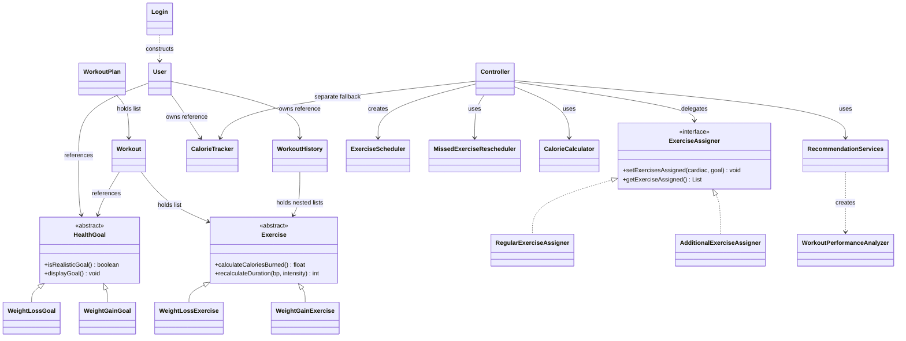
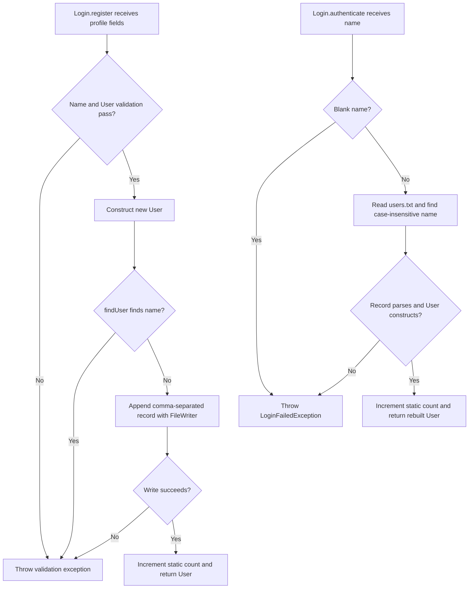
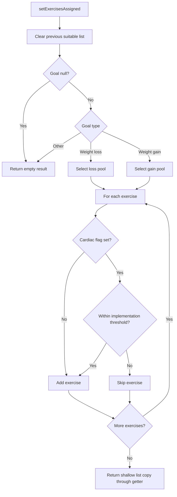
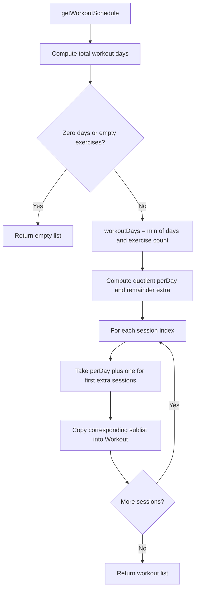
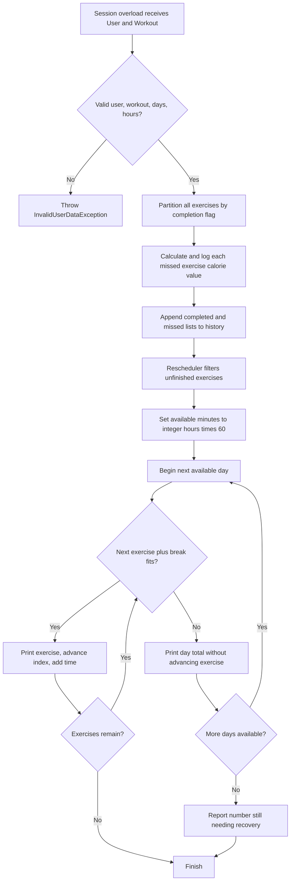
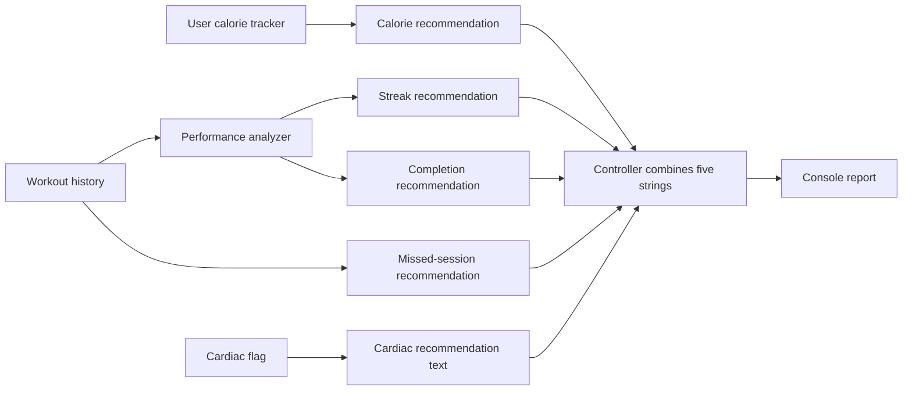
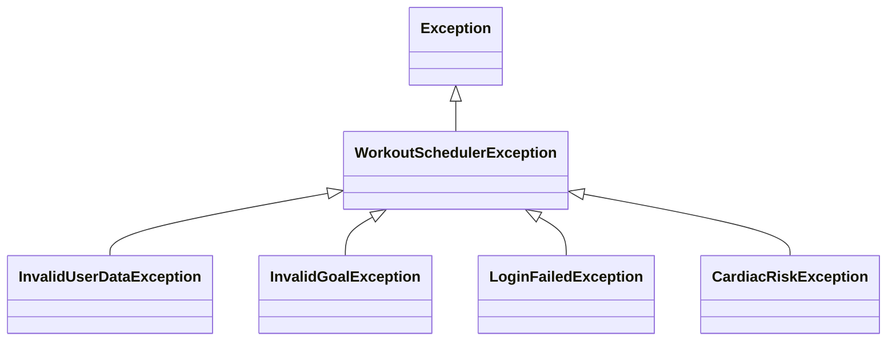

# Low-Level Design — Workout Scheduler

[README](../README.md) · [HLD](HLD.md) · [Viva guide](VIVA.md)

This document describes the implementation at base commit `4751e7b`. Names and spellings such as `computeNoOFExercisesperday` are kept exactly as in the code so you can find them.

## 1. What is LLD?

**Low-Level Design** explains how the modules are implemented: classes, fields, method contracts, branching decisions, formulas, and object relationships. A method contract describes its inputs, returned result, side effects, and failures.

## 2. Class inventory

Routine getters/setters are grouped here. Important methods and edge cases are explained in the following sections.

| Class / interface | Important state | Responsibility and key methods |
| --- | --- | --- |
| [Main](../src/Main.java) | Local sample objects | Static `main(String[])` runs the demonstration |
| [User](../src/models/User.java) | Profile fields, goal, history, tracker, static `idCounter` | Two constructors; validated setters; profile display; creates user-owned history/tracker |
| [HealthGoal](../src/goals/HealthGoal.java) | Protected name, days, target weight | Abstract `isRealisticGoal`, `displayGoal`; common accessors |
| [WeightLossGoal](../src/goals/WeightLossGoal.java) | Current weight, weekly loss rate | Two constructors; implements loss realism/display |
| [WeightGainGoal](../src/goals/WeightGainGoal.java) | Current weight, weekly gain rate | Two constructors; implements gain realism/display |
| [Exercise](../src/exercises/Exercise.java) | Protected ID, name, duration, sets, reps, completion, calorie cache | Abstract display, calorie calculation, duration adjustment |
| [WeightLossExercise](../src/exercises/WeightLossExercise.java) | Cardio type and intensity | Cardio calorie formula; BP/intensity adjustment |
| [WeightGainExercise](../src/exercises/WeightGainExercise.java) | Lifted weight, equipment, intensity | Strength calorie formula; BP/intensity adjustment |
| [ExerciseRepository](../src/exercises/ExerciseRepository.java) | No instance fields | Four static methods create fresh exercise pools |
| [ExerciseAssigner](../src/assigners/ExerciseAssigner.java) | Interface, no stored state | `setExercisesAssigned`, `getExerciseAssigned` contract |
| [RegularExerciseAssigner](../src/assigners/RegularExerciseAssigner.java) | Suitable exercise list | Regular goal/cardiac selection; returns a shallow list copy |
| [AdditionalExerciseAssigner](../src/assigners/AdditionalExerciseAssigner.java) | Suitable exercise list | Additional goal/cardiac selection; returns a shallow list copy |
| [ExerciseScheduler](../src/scheduler/ExerciseScheduler.java) | Exercises, target days, days/week, cursor, accumulated time, final five-minute break | Quota, initial schedule, cursor-based display/reset |
| [MissedExerciseRescheduler](../src/scheduler/MissedExerciseRescheduler.java) | Stored days, hours/day, final five-minute break | Print recovery schedule; separately return recovery workouts |
| [Workout](../src/workouts/Workout.java) | ID, goal reference, exercise list, duration | Two constructors; add/complete exercise; sum exercise durations |
| [WorkoutPlan](../src/workouts/WorkoutPlan.java) | Workout list | Two constructors; add session; one-based session lookup |
| [WorkoutHistory](../src/workouts/WorkoutHistory.java) | Parallel nested completed/missed lists | Add/update/filter/clear records; count missed sessions; generate report |
| [CalorieCalculator](../src/tracker/CalorieCalculator.java) | No stored instance state | Bounded generic calorie delegation and cache update |
| [CalorieTracker](../src/tracker/CalorieTracker.java) | Burn/missed totals, burn log list, daily target, BMR | BMR, four target overloads, two BMR overloads, logs, deficit, status display |
| [WorkoutPerformanceAnalyzer](../src/analytics/WorkoutPerformanceAnalyzer.java) | No stored instance state | Completion rate, streak, two descriptions, trend, best session |
| [RecommendationServices](../src/analytics/RecommendationServices.java) | No stored instance state | Five formatted rule-based recommendation methods |
| [Controller](../src/controller/Controller.java) | Assigner, schedulers, analytics, fallback history/tracker, generic calculator | Assign, plan, complete, two rescheduling overloads, combined recommendation |
| [Login](../src/login/Login.java) | Static filename and login count | Register, authenticate, count, private record lookup |
| [WorkoutSchedulerException](../src/exceptions/WorkoutSchedulerException.java) | Inherited exception message/cause | Checked base exception; message and message/cause constructors |
| [InvalidUserDataException](../src/exceptions/InvalidUserDataException.java) | Inherited message | Invalid profile/controller inputs and registration write failures |
| [InvalidGoalException](../src/exceptions/InvalidGoalException.java) | Inherited message | Null goal validation in User |
| [LoginFailedException](../src/exceptions/LoginFailedException.java) | Inherited message | Blank or missing/unreadable/unparseable name lookup |
| [CardiacRiskException](../src/exceptions/CardiacRiskException.java) | Inherited message | Declared for cardiac-risk failures; no throw site exists |

## 3. Main class relationships



The arrows for list ownership are associations, not strict lifecycle composition: lists and child objects can be supplied or replaced by callers. `<|--` means class inheritance; `<|..` means interface implementation; `..>` means a use dependency.

## 4. User creation and validation

The seven-parameter constructor chains to the eight-parameter constructor using `this(...)`, defaulting the cardiac flag to false. Validation runs before ID assignment and before trackers are created.

| Value | Accepted by the current checks | Failure |
| --- | --- | --- |
| Name | Non-null, nonblank after trim | `InvalidUserDataException` |
| Age | 1 through 120 inclusive | Same |
| Weight and height | Greater than zero according to comparison checks | Same |
| Goal | Non-null reference | `InvalidGoalException` |
| Days/week | 1 through 7 inclusive | `InvalidUserDataException` |
| Hours/day | Greater than zero and at most 24 | Same |
| BP setter | Greater than zero according to comparison check | Same |

Successful construction assigns the next static ID, sets BP to 120, creates empty history/tracker objects, calculates BMR with `isMale=true`, and calculates a goal/activity target.

Age/weight/height setters refresh BMR and target; goal/days/hours setters refresh the target. The BP and cardiac setters do not automatically change assigned exercises. Validation does not call `goal.isRealisticGoal()`. A goal can be non-null yet unrealistic.

**Edge case:** float checks do not explicitly reject `NaN` or all infinity cases. The code also allows replacement of history/tracker references with null. These are boundaries of the current validation, not guarantees of fully valid state.

## 5. Goals

| Goal | Rejects when | Final realism rule |
| --- | --- | --- |
| Loss | Current weight is not above target; days/rate nonpositive; configured loss rate above 1.5 | `(current - target) / (days / 7.0) <= 1.5` |
| Gain | Target is not above current; days/rate nonpositive; configured gain rate above 1.0 | `(target - current) / (days / 7.0) <= 1.0` |

The final comparison uses the class's fixed threshold. It does **not** compare the required weekly rate to the configured weekly rate. Constructors store values without throwing `InvalidGoalException`; the boolean check reports realism separately.

## 6. Registration and name lookup



`register(...)` returns a new `User`, rejects an existing name through `findUser`, writes a record, and increments the counter. Duplicate detection happens **after** User construction, so even rejected duplicates can consume an ID.

`authenticate(String)` performs name lookup, not password verification. `findUser` reads the entire file character by character into a `StringBuilder`, splits lines, and parses the first matching record with at least ten fields. File read/parse/construction errors lead to null, which authentication converts to `LoginFailedException`.

Current file schema:

```text
name,age,weight,height,cardiacFlag,goalName,targetDays,targetWeight,daysPerWeek,hoursPerDay
```

A goal name containing `gain` reconstructs a `WeightGainGoal` at a fixed rate of 0.5. All other names reconstruct a `WeightLossGoal` at rate 1.0. Goal current weight comes from the profile weight. BP, ID, original goal current weight/rate, history, and calorie state are not restored.

`try (FileReader ...)` and `try (FileWriter ...)` close resources automatically. Neither uses a buffered wrapper despite the wording in `Main` output. There is no escaping for commas/newlines in names, file locking, password handling, or persistent login count. Both registration and authentication increment `loginCount`, so the first successful demo reports 2.

## 7. Exercise pools and assignment

The repository creates five regular and four additional objects per goal type, each time a pool method is called. Exercise constructors calculate the initial calorie cache.



| Implementation | Loss cardiac intensity maximum | Gain cardiac intensity maximum |
| --- | --- | --- |
| Regular | 5.0 | 5.5 |
| Additional | 4.5 | 4.5 |

Without the cardiac flag, all exercises from the chosen pool are selected. Unknown goal subclasses yield an empty list. No assigner throws `CardiacRiskException` or calls `recalculateDuration`.

`new ArrayList<>(suitableExercises)` protects the internal list container from direct add/remove operations by a caller. The exercise objects inside are still shared: changing their fields is visible through other references.

## 8. Exercise formulas and adjustments

These formulas describe repository behavior and are educational estimates.

```text
Cardio:
  calories = durationMinutes * (6 + intensity * 0.8)
  if sets > 1: add sets * reps * 0.2

Strength:
  calories = durationMinutes * (3 + intensity * 0.4)
           + sets * reps * weightLifted * 0.04
```

Each overridden calculation writes `calculatedCalories` and returns it. `CalorieCalculator<T extends Exercise>` accepts only an Exercise-bounded type. Its method `<E extends T> float calculateCalories(E)` returns 0 for null; otherwise a `Function<E, Float>` lambda calls the overridden calculation, then the helper sets the cache again. Converting the primitive return value to `Float` and back uses autoboxing/unboxing.

| Adjustment | Loss exercise | Gain exercise |
| --- | --- | --- |
| BP > 140 | Duration multiplied by 0.75 | Duration and lifted weight multiplied by 0.80 |
| Otherwise BP > 130 | Duration multiplied by 0.85 | Duration multiplied by 0.90 |
| Minimum adjusted duration | 10 minutes | 10 minutes |
| Input intensity > 8 | Set intensity to 8 | Set intensity to 8 |
| Input intensity > 0 and <= 8 | Set to supplied intensity | Set to supplied intensity |

The method recalculates calories afterward. Repeated adjustments act on already modified fields; they are not resets to original values. These methods are not called in the demo.

## 9. Initial scheduling

There are two related operations with different responsibilities.

### Quota and cursor display

```text
totalWeeks = (targetDays + 6) / 7             // integer ceiling for positive days
totalWorkoutDays = totalWeeks * daysPerWeek
quota = ceil(exerciseCount / totalWorkoutDays)
```

If workout days are zero, the quota is zero. `displayScheduledExercises` prints at most that quota starting at `currentIndex`, adds five-minute breaks between exercises, and advances the cursor. `resetScheduleIndex` resets only the cursor. `hasMoreExercises` checks whether the cursor is below list size.

### Returned workout list



`getWorkoutSchedule` does not use or advance the display cursor. It uses all exercises once, in order, placing remainder exercises in earlier sessions. For five exercises, 60 target days, and five days/week: weeks = 9, possible days = 45, actual sessions = 5, quota = 1. It creates five one-exercise sessions, not 45 recurring sessions.

The scheduler is count-based, does not accept `hoursPerDay`, and stores no dates. Direct invalid/null inputs are not comprehensively checked; normal controller use relies on valid user fields but does not enforce a realistic goal.

## 10. Workout, plan, and history contracts

- `Workout` stores an input exercise list by reference. Its duration is the sum of exercise durations, **excluding breaks**. Adding or setting exercises recalculates duration. Changing an exercise duration directly can leave the cached workout duration stale until recalculated.
- `Workout.markCompletedExercise(id)` changes the first matching flag without logging calories. `Controller.completeExercise` additionally calculates and logs calories in the controller tracker. Null workouts and missing IDs silently do nothing in the controller method.
- `WorkoutPlan.getWorkoutForDay(dayNumber)` uses a one-based position. It returns null outside the list range; the number is not a date or necessarily the workout's ID.
- `WorkoutHistory` stores parallel `List<List<Exercise>>` collections. Outer index = session; inner list = exercise references recorded for that session. `addWorkoutRecord` substitutes empty lists for null arguments.
- `updateWorkoutRecord` uses a zero-based index and replaces non-null supplied lists. Invalid indexes are ignored. Public setters can break the intended alignment.
- `getMissedWorkoutsCount` counts sessions with any missed exercise. It does not count missed exercises.
- `getHistoryByCompletionStatus` accepts `completed` or `missed` ignoring case; other values return a new empty list.
- `generateHistoryReport(userId)` uses the ID as a printed label; `clearHistory(userId)` clears this object's history without filtering by ID. Each history object is intended to belong to one user.

## 11. Missed-exercise rescheduling

The controller overloads are distinct:

| Method | Inputs and checks | Side effects |
| --- | --- | --- |
| `rescheduleMissedExercises(user, days, hours)` | User non-null, days/hours positive | Collect all missed lists from existing history; print recovery schedule; no new record or calorie log |
| `rescheduleMissedExercises(user, workout, days, hours)` | Same, plus non-null workout | Partition by completion; calculate/log missed calories in user tracker; append history; print recovery schedule |



The printing method uses ordered greedy allocation: it tries the next exercise, never sorts, splits, or skips ahead, and adds a five-minute break only after the first exercise of a day. An exercise too long for any day stays at the front and prevents later smaller exercises from being scheduled. Available minutes are truncated to an integer.

The separate `getRescheduledWorkouts(list, goal, startId)` returns new workout objects. It depends on `noOfDays`/`hoursPerDay` stored by the printing call; before any call these fields are zero. It does not filter completion flags, and it **allows an oversized first exercise** because its overflow check requires the day's list to be nonempty. Its returned workouts are not appended automatically to a plan. Do not claim that this API enforces the same strict limit as the printing method.

## 12. BMR and calorie tracking

The implementation uses:

```text
BMR = 10 * weightKg + 6.25 * heightCm - 5 * age + genderFactor
genderFactor = +5 if isMale is true, otherwise -161
activityMultiplier = 1.55 for >= 5 days/week
                   = 1.375 for >= 3 days/week
                   = 1.2 otherwise
baseTarget = BMR * (activityMultiplier - 1) + hoursPerDay * 200
lossDeficit = weeklyLossRate * 7700 / 7
weightLossTarget = max(baseTarget, lossDeficit)
```

When stored BMR is not positive, the activity overload uses `daysPerWeek * hoursPerDay * 150`. The no-argument target method supplies `BMR * 0.35` only if target is zero and BMR is positive. The four target overloads are: no arguments; days/hours; BMR/days/hours; goal/days/hours. Two BMR overloads either return stored BMR or compute it from body fields.

`User` always supplies `isMale=true`; there is no gender profile field. Gain goals use the base activity target without a special gain-rate calculation.

`logCalorieBurn(value)` increments the total and appends one value. `logMissedCalories(value)` increments the missed total only. There are no timestamps or per-day aggregation. Remaining target is `dailyTarget - latestBurnEntry`, or the entire target if no burn exists. Although the list is named `caloriesBurntPerDay`, each call is just a log entry.

## 13. Analytics and recommendations



| Metric | Algorithm / thresholds |
| --- | --- |
| Completion rate | `completed / (completed + missed) * 100`, with float division; zero for null/empty history |
| Current streak | Scan sessions backward; count consecutive sessions with completed entries and no missed entries; stop at first failure |
| Analyzer completion description | Bands >= 90, >= 75, >= 50, below 50 |
| Recommendation completion advice | Separate bands >= 85, >= 60, below 60 |
| Streak advice/descriptions | Bands >= 14, >= 7, > 0, zero |
| Progress trend | Compare last two calorie entries; increase above +20, decrease below -20, otherwise stable; fewer than two = insufficient data |
| Best performing day | Find session with most completed entries; earliest wins ties; output is a session number, not a date |
| Calorie advice | Positive remaining target asks for more burn; zero/negative reports target reached; display missed total when positive |
| Recovery advice | Choose text according to whether any sessions contain missed entries |
| Cardiac advice | Choose text using flag only; message mentions intensity <= 6, which differs from assigner thresholds |

The analyzer's text bands differ from the recommendation service's bands. Progress trend/best session and analyzer description helpers exist but are not included in `Controller.getRecommendation`. Streaks are session-based, not calendar-day streaks. The system does not use machine learning.

## 14. Exception flow



All custom exceptions are checked because their base extends `Exception`. Callers must catch them or declare `throws`. `throw` raises an instance; `throws` declares a possible checked failure. The demo catches invalid input and login failures, prints messages, and returns early for a failed valid registration/authentication. Some other sections catch broad `Exception`.

`InvalidGoalException` currently checks null goals in User, not every invalid numeric goal parameter. `CardiacRiskException` has no use beyond declaration. Login's read/parse failures lose their detailed cause because `findUser` returns null.

## 15. Complexity at a glance

Let E = exercises, S = sessions, and B = profile file size in characters.

| Operation | Approximate cost |
| --- | --- |
| Name lookup | O(B) time and memory: reads the entire file before scanning records |
| Exercise assignment | O(E) time, O(E) result references |
| Initial schedule | O(E + S) time and result storage |
| Find exercise by ID | O(E) time |
| Session partition/history logging | O(E) time and new list references |
| Printed recovery | O(E + availableDays) for the ordered traversal, excluding console I/O cost |
| Completion/best-session calculation | Linear in stored exercise counts or session count respectively |
| Current streak | O(S) worst case, often stops early |

These are implementation observations for this small project, not measured performance benchmarks.

## Limitations and edge cases

Use this list for honest viva answers and future work:

1. A second full demo in the same directory stops at duplicate registration. No demo reset or login fallback is provided.
2. Name lookup is not secure authentication; names containing commas/newlines are not encoded safely.
3. Text persistence rebuilds new objects and IDs; ID stability and nested runtime state are absent.
4. Initial `Main` goal says current weight 80 while the profile weighs 65 and targets 70. After lookup, the rebuilt loss goal uses 65 and is unrealistic. Registration does not reject that realism result.
5. Goal constructors/setters store unvalidated values; user validation mostly checks profile ranges and non-null goal reference.
6. Completing the same exercise twice logs calories twice; recording the same session twice appends history/missed calories twice.
7. Mutable lists and shared exercise references allow state changes across views; cached durations/calories are not always refreshed by setters.
8. Initial plans are one-pass session lists; recovery output is not saved to the plan. There is no calendar or recurring schedule.
9. Printing and object-returning recovery methods differ on oversized exercises and completion filtering.
10. Calorie entries have no date grouping; BMR uses a fixed male flag in User. Formulas are educational rules.
11. `Serializable` is declared on User only. Its non-null goal/history/tracker references do not implement Serializable, so ordinary full-object serialization would fail. Login does not use Object streams.
12. No multi-user concurrency, persistence transactions, or automated project test suite is present.
